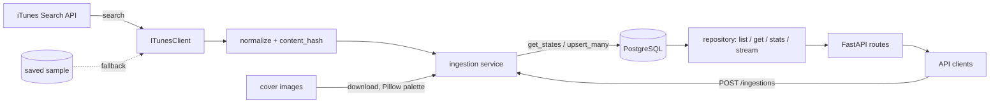

# Notes

Decisions, trade-offs and what I'd do next. The README covers how to run it.

## Architecture

The code follows those layers: `api/` (HTTP: routes, auth, errors, response
schemas), `services/` (ingestion, normalization, palettes), `repositories/` (SQL),
`clients/` (iTunes). One `Audiobook` model (`models.py`) is shared by all of them.
Dependencies point one way: routes call services and repositories, services call
repositories and clients, and repositories only know the model. Only `api/` knows
about FastAPI.

## Storage

**PostgreSQL, with raw SQL through async psycopg.**

- Why Postgres: ingestion needs an idempotent upsert (`INSERT ... ON CONFLICT`),
  stats are a `GROUP BY`, the export needs server-side cursors to stream, and the
  palette fits naturally in a JSONB column. It also holds up at the "hundreds of
  thousands of records" the brief mentions, and well beyond. I briefly considered
  SQLite (zero setup for reviewers), but it has a single writer and is a weaker
  answer for scale; Docker Compose makes Postgres a one-command setup anyway.
- Why raw SQL instead of an ORM: there are only a handful of queries, and I wanted
  each one visible and explainable (the upsert in particular). The cost is
  hand-written mapping between rows and the model. Queries that are assembled from
  parts (the list filters) use `psycopg.sql`, so user input only ever travels as a
  parameter.
- **Schema:** a single idempotent `schema.sql` applied at startup. Simple, but it
  only creates what's missing: changing an existing column needs a manual
  `ALTER TABLE` or a database reset. In production I'd use versioned migrations.
- **The primary key is the iTunes `collectionId`**, not an internal id. It's
  simpler, stable across rebuilds, and the id clients see in iTunes. The trade-off
  is coupling to one source: adding a second one would mean an internal id plus a
  unique `(source, source_id)`.

## Ingestion

`POST /ingestions` fetches, cleans, compares with what's stored, computes palettes
for what's new or changed, and upserts.

- **Idempotency:** each cleaned record gets a SHA-256 `content_hash` of its stored
  fields (canonical JSON, sorted keys). Fields I don't store (price, artist URLs)
  don't count as changes, and neither do differences that cleaning removes
  (whitespace, HTML entities). Same hash means unchanged, so it's skipped.
- **The database counts what happened:** the upsert only updates a row when the
  hash or the palette actually differs
  (`ON CONFLICT ... DO UPDATE ... WHERE (content_hash, palette) IS DISTINCT FROM ...`),
  so identical rows are real no-ops and `updated_at` only moves on real changes.
  `RETURNING (xmax = 0)` tells inserts from updates (`xmax` is a Postgres system
  column that is 0 on a row the statement just inserted; a common idiom, though it
  relies on an implementation detail). So the counts stay correct even if two
  ingestions overlap.
- **Summary:** `fetched`, `created`, `updated`, `skipped`, plus `invalid` (each
  rejected record with its reason). `skipped` covers unchanged records, invalid
  ones and failed palette retries, so `fetched == created + updated + skipped`
  always holds.
- **Transactions and connections:** the batch is written in one transaction (all or
  nothing). Ingestion borrows a database connection only for the two short queries
  (read stored hashes, then upsert), never while downloading covers.
- **Fallback:** if iTunes fails (network error, timeout, non-2xx status including
  rate limiting, invalid JSON), ingestion uses a saved sample of real iTunes data
  and reports `source: "fallback"`. The sample is a fixed snapshot, returned
  whatever the search was; it ships inside the package so it's in the Docker image.
- **Search parameters** (`term`, `limit`, `country`, `attribute`) are validated and
  passed through. iTunes sometimes returns a few more results than `limit`; I
  report what it sent rather than trimming.

## Validation rules

Normalization turns each raw record into a clean `Audiobook` or an
`InvalidRecord(source_id, reason)`.

- **Required** (otherwise the record is skipped, with the reason):
  - a JSON object;
  - a positive integer `collectionId` (with `bool` excluded explicitly, since
    `True` is an `int` in Python);
  - `wrapperType == "audiobook"`;
  - a non-empty title.
- **Optional:** author, description, genre, release date and cover URL become
  `null` when missing or unusable. A bad optional field never costs the record.
- **Cleaning:**
  - descriptions: HTML to plain text with BeautifulSoup (block tags become line
    breaks, `<script>`/`<style>` dropped, entities decoded). I parse rather than
    strip tags with a regex, which breaks on literal `<` in text, attributes and
    comments;
  - titles, authors, genres: entities decoded, whitespace collapsed;
  - release date: parsed from the ISO timestamp;
  - cover URL: kept as it comes, if it's an absolute http(s) URL;
  - title suffixes like "(Unabridged)" are kept: they're real information.
- **Duplicates in one batch:** the first record wins, later ones are reported as
  invalid.
- **Safety net:** the `Audiobook` model is a strict, frozen Pydantic model with its
  own constraints (`id > 0`, non-empty title, palette format), so a bug in cleaning
  becomes a skipped record instead of bad data in the database.

## Cover palettes

- Computed with Pillow's median-cut quantization: up to 5 `#rrggbb` colors, ordered
  by how much of the image they cover. I first used colorthief, but testing showed
  its colors aren't ordered by dominance, and it repeats and invents colors, so I
  replaced it with the simpler tool underneath.
- A failed download or unreadable image never fails the record: the palette is
  `null` and a warning is logged. On the next ingestion, an unchanged record with a
  `null` palette (and a cover) is retried.
- Downloads run concurrently (10 at a time by default) and the image work runs in a
  thread, since it's CPU-bound.
- Palettes come from iTunes' 100×100 covers as provided; enough for the main
  colors. There's no image size limit yet.

## Export

`GET /audiobooks/export` streams the whole catalog as **NDJSON** (one JSON object
per line, same fields as the list items, ordered by id).

- Why NDJSON: one big JSON array has to be built (and often parsed) in one piece;
  NDJSON can be produced and consumed line by line.
- **Constant memory:** rows come from a server-side (named) cursor, 1,000 at a time,
  and each batch is written out as one chunk. Only one batch is in memory at once,
  whatever the catalog size.
- **Consistent:** it's a single statement, so it sees one snapshot of the table even
  while an ingestion writes to it (there's a test for this).
- The streaming body is sent after the route function returns, so the generator
  borrows its own connection for exactly as long as the stream lasts, and closes the
  database cursor immediately if the client disconnects.
- Each running export holds a database connection, so the pool grows from 2 up to
  `DB_POOL_MAX` (10 by default).
- Limitation: once the first bytes are sent, the status is 200; an error halfway
  through shows up to the client as a truncated file.

## API design

- Flat routes, as the brief asks: `/ingestions`, `/audiobooks`, `/audiobooks/{id}`,
  `/audiobooks/export`, `/stats`, `/health`.
- **Health:** `/health` runs `SELECT 1` against Postgres with a 1-second deadline:
  200 if it answers, 503 otherwise. It's a readiness check ("can this instance serve
  requests?"), so a load balancer or Docker stops treating an instance as healthy
  when it loses its database. The trade-off: if Postgres goes down, every instance
  reports unhealthy at once, and an orchestrator that *restarts* unhealthy
  containers would restart them all for nothing; with separate checks, I'd keep a
  plain liveness endpoint (process up) for restarts and this one for traffic.
- **Auth:** a static key in `X-API-Key`, compared in constant time. Missing and
  wrong keys both get 401 (there's no "authenticated but forbidden" case). `/health`
  and the docs are public.
- **Errors:** one shape everywhere, `{"error": {"code", "message", "details"?}}`,
  including the router's own 404/405 and validation errors (422, with the offending
  field in `details`). Unexpected errors return a generic 500 and are logged; no
  internals leak.
- **Pagination:** `limit`/`offset` with a `total`, which is easy to use and to try
  in Swagger. Sorted by title, with the id breaking ties so pages never overlap. The
  total comes from a separate count, since a page past the end has no rows to carry
  it.
- Responses don't include `content_hash`: it's an internal detail.
- Stats are lists with explicit `null` buckets for audiobooks without a genre or
  release date.

## Configuration

Environment variables, read with pydantic-settings (`.env` as a fallback for local
runs). Defaults live only in the code; Docker Compose passes optional variables
through without values, so unset ones fall back to those defaults. The app refuses
to start without the required ones.

## Testing

What I tested and why:

- **Anything involving SQL runs against a real Postgres** (a separate
  `audiobook_test` database): idempotency, counts, transactions, filters,
  pagination, the export's batching and snapshot. Mocking the database would test
  the mock, not the upsert.
- **The database tests fail instead of skipping** when Postgres isn't running, so
  they can't silently stop running, locally or in CI.
- **Upstream services are faked** with `httpx.MockTransport` (iTunes and cover
  images), so tests need no network. Ingestion scenarios cover first runs, repeats
  (no cover is downloaded twice), upstream changes, invalid records, failed covers
  and their retry, and the fallback. Every ingestion test also asserts the
  `fetched == created + updated + skipped` invariant.
- **Normalization** has table-driven tests for every rule, plus a check on the real
  sample.
- I checked that important tests actually fail when the code is broken, which found
  a couple that didn't (search tests without decoys for `%`/`_`, a sort test where
  insertion order hid a missing tie-breaker); I fixed those.
- Not tested, on purpose: constant memory at scale (argued from the design rather
  than with a slow, flaky test) and the real iTunes API.

CI (GitHub Actions) runs lint, strict type checking and the tests against a
Postgres service, and a smoke test that starts the stack from `.env.example` with
Docker Compose and calls the API, like the README's quick start.

## Trade-offs and what I'd do with more time

- Versioned migrations instead of `schema.sql`.
- Keyset pagination instead of `offset` (deep offsets get slow); the same idea
  would allow resumable exports (`?after_id=`).
- Retries with backoff, caching and rate limiting for calls to iTunes.
- Logging configuration: the app's own INFO logs (like the ingestion summary) don't
  show yet because logging isn't configured; I'd add structured JSON logs and a
  metrics endpoint.
- Gzip for the export, and a size limit for cover images.

## How I used AI tools

I used Claude Code throughout.

- **Planning:** I had it read the brief and ask me about every decision before
  writing code (storage, export format, validation rules, error shape, test
  strategy and so on). The decisions went into `PLAN.md` (not commited).
- **Building:** for each milestone it proposed a roadmap, then wrote the pieces I
  asked for, one at a time, and I reviewed each before moving on.

## Deploying to production (AWS)

- **Runs on:** the same Docker image on ECS behind an Application Load
  Balancer, which uses the health endpoint; autoscaling on CPU or request count.
- **Storage:** RDS for PostgreSQL, Multi-AZ, with automated backups.
- **Secrets:** the API key and database credentials in AWS Secrets Manager,
  injected into the containers as environment variables; nothing secret in the image
  or the repository.
- **Shipping a new version:** CI runs the checks, builds the image, tags it with the
  commit and pushes it to ECR; migrations run as a separate step; then a rolling
  deploy replaces containers only once the new ones are healthy. Rolling back means
  redeploying the previous tag.

## Continuous ingestion and millions of records

To ingest continuously, ingestion would move out of the HTTP request into workers
fed by a queue: a scheduler periodically enqueues search terms (or genres and
countries), workers fetch and upsert batches (already idempotent, so retries are
safe), with rate limiting and backoff toward iTunes and cached responses. Palette
computation would become its own queued job, retried independently. At millions of
records, the API would switch to keyset pagination, heavy reads and exports
would go to read replicas, and the export itself would become an asynchronous job
that writes a file to S3 and returns a signed URL, instead of a long-lived HTTP
stream.
